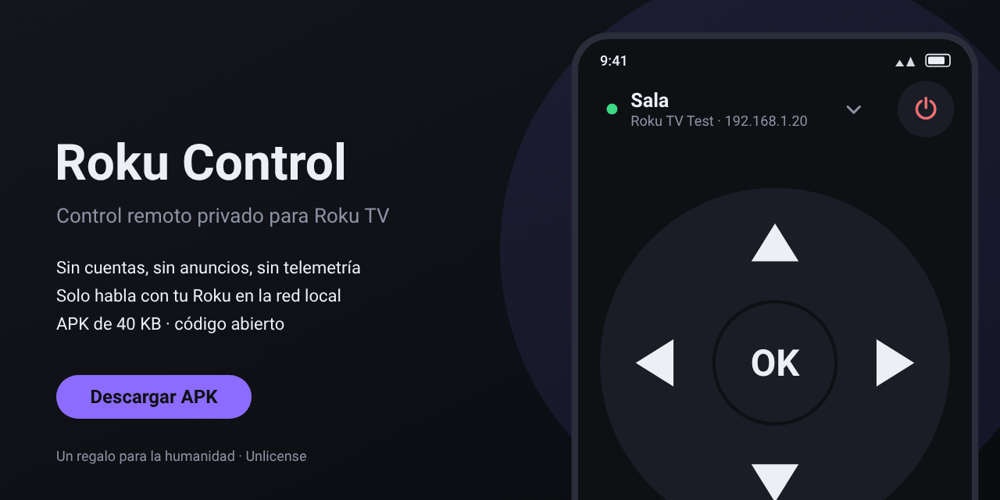
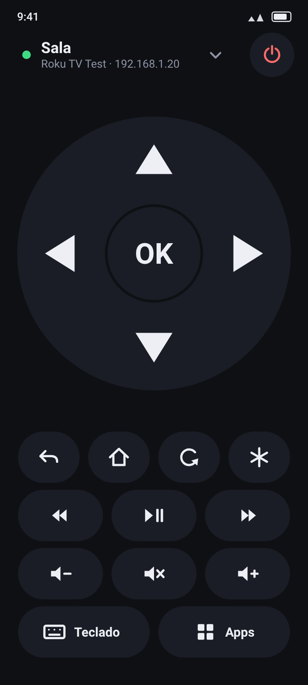
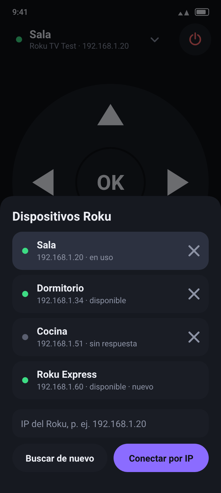
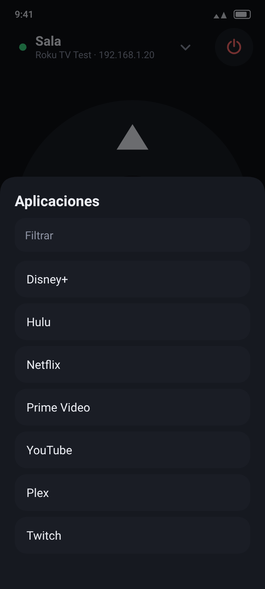
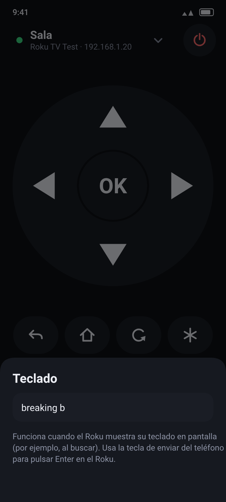
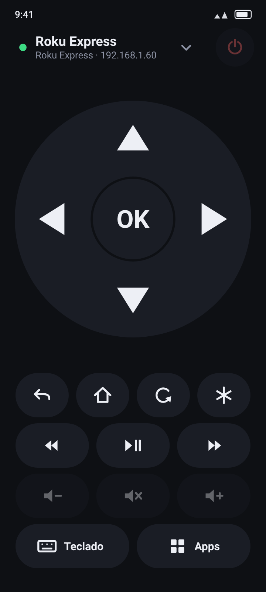

<div align="center">



# Roku Control

**Control remoto privado para Roku TV y reproductores Roku.**
Sin cuentas, sin anuncios, sin telemetría. Habla solo con tu Roku, dentro de tu red local.

### [⬇ Descargar el APK (40 KB)](https://github.com/web-gdl/RokuControl/raw/main/descargas/RokuControl.apk)

Android 8.0 o superior · versión 1.0.0 · [Suma SHA-256](descargas/SHA256SUMS.txt)

</div>

---

## Por qué existe

Las apps de control remoto para Roku suelen pedir cuenta, mostrar anuncios o enviar estadísticas, cuando la tarea real es enviar unas pocas órdenes HTTP al televisor. Roku Control hace solo eso: usa el protocolo oficial de control externo de Roku (ECP, puerto 8060) y nada más.

- **Cero telemetría, publicidad y rastreadores.** Sin SDK de terceros: el APK contiene únicamente código propio.
- **Solo red local.** La app rechaza cualquier dirección que no sea de tu red (10.x, 172.16–31.x, 192.168.x, 169.254.x).
- **Sin cuentas ni nube.** Lo único que se guarda en el teléfono es el número de serie, la IP y el nombre de tus Roku.
- **Ligera.** 40 KB, sin bibliotecas, arranque inmediato, sin tráfico mientras no la estás mirando.
- **Verificable.** El código es abierto y `./audit.sh` revisa el APK (ver [Privacidad](#privacidad-y-seguridad)).

## Imágenes

> Son **renders** hechos con las mismas medidas, colores y trazos que el código (`docs/preview/render.py`), con datos de ejemplo. **No son capturas reales** de un teléfono.

| Control | Dispositivos | Apps | Teclado | Reproductor |
|:-:|:-:|:-:|:-:|:-:|
|  |  |  |  |  |

En un reproductor Roku (Express, Streaming Stick, Ultra) los botones de volumen y encendido se muestran atenuados: esas funciones solo existen en Roku TV. Al tocarlos, la app explica por qué.

## Funciones

- **Detección automática** de Roku en la red (SSDP) o conexión por **IP manual**.
- **Recuerda** tus dispositivos y **reconecta sola**, incluso si el router le cambia la IP al Roku.
- Cruceta con **OK**, Atrás, Inicio, Repetir escena y Opciones (\*); retroceder, reproducir/pausa y avanzar.
- Flechas y volumen **se repiten al mantener pulsado**, como un control físico.
- **Roku TV:** encender/apagar, volumen +/− y silencio.
- **Teclado:** escribe en el teléfono y el texto llega al teclado en pantalla del Roku (incluye acentos, ñ y símbolos).
- **Aplicaciones:** lista de canales instalados con filtro; un toque los abre.
- Indicador de estado: verde (conectado), ámbar (conectando o reconectando), gris (sin dispositivo).
- Tema oscuro, botones grandes para una mano, sin pantallas de bienvenida ni ventanas emergentes.

## Instalación

1. [Descarga el APK](https://github.com/web-gdl/RokuControl/raw/main/descargas/RokuControl.apk) en tu teléfono Android y ábrelo (Android te pedirá permitir instalar desde esa fuente). También con adb: `adb install RokuControl.apk`.
2. Conecta el teléfono a la **misma red Wi-Fi** que el Roku y abre la app. Si hay un solo Roku, se conecta solo.
3. En el Roku, activa **Configuración → Sistema → Configuración avanzada del sistema → Control por aplicaciones móviles → Habilitado** (obligatorio desde Roku OS 14.1). Si está limitado, la app te lo indica.

**Verificar la descarga:** `sha256sum -c SHA256SUMS.txt` (dentro de `descargas/`). El APK está firmado con un certificado cuya huella SHA-256 es:

```
FD:CC:7A:ED:AB:9B:1A:D5:7B:A7:C8:8B:E9:90:C2:91:8F:CC:99:8C:CE:33:08:5E:09:87:18:50:EB:95:48:EB
```

(se puede comprobar con `apksigner verify --print-certs RokuControl.apk`). Es una clave propia del proyecto, no de una tienda de aplicaciones: las actualizaciones solo se instalan encima si están firmadas con la misma.

## Privacidad y seguridad

Permisos (3), todos justificados en [`docs/PRIVACIDAD.md`](docs/PRIVACIDAD.md):

| Permiso | Motivo |
|---|---|
| `INTERNET` | Android lo exige para cualquier conexión, también a la red local. El destino se limita por código a direcciones locales. |
| `ACCESS_NETWORK_STATE` | Usar la red Wi-Fi/Ethernet aunque haya datos móviles activos. |
| `CHANGE_WIFI_MULTICAST_STATE` | Recibir las respuestas al buscar Roku (solo durante la búsqueda). |

La auditoría automática (`./audit.sh`, resultado en [`docs/auditoria-salida.txt`](docs/auditoria-salida.txt)) comprueba exactamente esos permisos, la ausencia de servicios y receptores en segundo plano, de bibliotecas nativas y de SDK de terceros, y que no hay URLs ni cadenas de analítica, publicidad o rastreo.

**Lo que no se afirma:** que sea «100 % privada». El protocolo ECP usa HTTP sin cifrar, así que cualquiera en tu red Wi-Fi puede ver o enviar las mismas órdenes; y no se auditó el tráfico real en un teléfono físico. Todo está en el [informe de privacidad](docs/PRIVACIDAD.md).

## Estado y límites

- **Probado:** el protocolo, la búsqueda, la reconexión y la validación con **64 pruebas** contra un Roku simulado ([`docs/pruebas-salida.txt`](docs/pruebas-salida.txt)); el APK compila y su firma (v2 + v3) se verifica.
- **No probado todavía:** en un teléfono y un Roku reales, ni cómo se ve la interfaz en pantalla. Si algo falla, abre un *issue* con el modelo del Roku y la versión de Android.
- El botón de encendido del TV en espera usa la tecla `PowerOn`, que la documentación de Roku no lista; en muchos modelos funciona, pero no está verificado.
- Un TV completamente apagado y sin red en espera no puede encenderse por ECP.
- Volumen y encendido: solo Roku TV. El teclado funciona cuando el Roku muestra su teclado en pantalla.

Lista completa: [`docs/LIMITACIONES.md`](docs/LIMITACIONES.md).

## Compilar y probar

Sin Gradle ni dependencias: `aapt2 → javac (Java 8) → D8 → apksig`. Pasos en [`docs/COMPILAR.md`](docs/COMPILAR.md).

```bash
./build.sh   # genera out/RokuControl-1.0.0.apk (firma v2+v3 verificada)
./test.sh    # 64 pruebas en la JVM contra un Roku simulado (puerto local 8060 libre)
./audit.sh   # auditoría de privacidad del APK
```

## Estructura

```
src/app/rokuremote/
  ecp/    protocolo: EcpClient (HTTP), SsdpDiscovery, DeviceInfo, RokuApp, Hosts (validación)
  core/   lógica: RemoteController (estado, reconexión, órdenes), repositorio, textos
  data/   Android: preferencias privadas y enlace a la red Wi-Fi
  ui/     MainActivity, cruceta, botones, hojas de dispositivos/apps/teclado
test/     pruebas JVM + Roku simulado
docs/     arquitectura, privacidad, limitaciones, compilación, imágenes (preview/render.py)
descargas/  APK firmado y suma SHA-256
```

Más detalle en [`docs/ARQUITECTURA.md`](docs/ARQUITECTURA.md). El nombre interno del paquete es `app.rokuremote`.

## Licencia

**Un regalo para la humanidad.** Este proyecto es de dominio público bajo [The Unlicense](LICENSE): úsalo, cópialo, modifícalo, véndelo o compártelo con o sin cambios, para cualquier fin y sin pedir permiso.

## Créditos y avisos

- Los iconos de la app están dibujados por código; no incluye imágenes de terceros. Las imágenes de esta página usan la tipografía Roboto (Apache 2.0).
- *Roku* es una marca de Roku, Inc. Este es un proyecto independiente, sin relación con Roku, Inc. Usa su protocolo público de control externo ([documentación de ECP](https://developer.roku.com/docs/developer-program/discovery/external-control-api.md)). Los nombres de apps que aparecen en las imágenes son ejemplos de texto.
